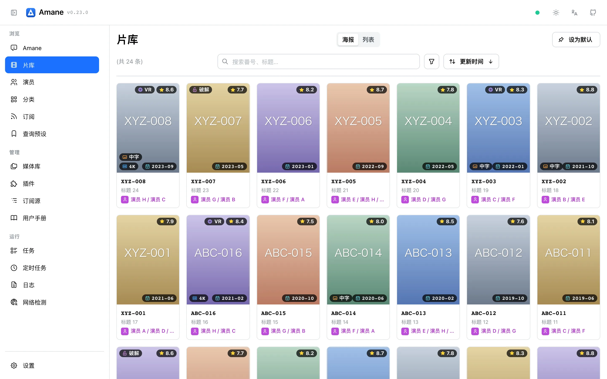

<div align="center">


# Amane

**AI 时代的私人影库**

多源刮削 · 元数据管理 · 字段级择优 · 数据私有 · 自托管服务 · 智能体协同 · 多端覆盖 · 开放扩展 · Emby / Jellyfin 适配

[](https://github.com/lingmeng1234/aname/releases)
[](https://github.com/lingmeng1234/aname/pkgs/container/amane)
[](https://sqzw-x.github.io/amane/)
[](LICENSE)

[用户文档](https://sqzw-x.github.io/amane/) · [下载](https://github.com/lingmeng1234/aname/releases) · [更新日志](CHANGELOG.md) · [反馈问题](https://github.com/lingmeng1234/aname/issues/new/choose)

</div>

---

Amane 是一个影片**元数据服务**, 核心是数据库中以番号为单位的影片条目. 番号可以手工输入、按模板批量生成、从 RSS 订阅中发现, 也可以由智能体或媒体库扫描提交.

Amane 不是 Emby / Jellyfin 的替代品, 而是它们的元数据补充: 媒体服务器负责媒体文件的管理、播放与串流, Amane 提供多源元数据, 并以 NFO 与图片的形式写到视频旁.

<picture>
  <source media="(prefers-color-scheme: dark)" srcset="docs/assets/screenshots/meta-wall-dark.webp">
  
</picture>

## 亮点

| | |
|---|---|
| **多源字段择优** | 内置 25 个影片站点, 按内容类型配置站点顺序, 每个字段可单独调整优先级或排除站点. |
| **完全数据所有权** | 各站点的原始结果、图片与译文都保存在本地 SQLite 与资源目录中; 来源站点下线后数据仍然可用, 重新刮削只请求缺失的站点. |
| **为管理而设计的界面** | 海报墙与多维筛选、对比来源、字段锁定、分类治理、评论与用户标签, 刮削结果可以逐字段审阅与修订. |
| **AI Native 设计** | 通过内置智能体使用自然语言检索片库、批量整理标签、发起刮削; 也可让外部智能体经 CLI 操作 Amane. |
| **多种番号来源** | 单个番号、模板批量生成、RSS 订阅、智能体、定时重新刮削, 以及可选的媒体库扫描. |
| **与媒体服务器互补** | 需要时把元数据整理为 NFO、海报、封面、剧照与字幕写到视频旁, Emby / Jellyfin 直接识别. |
| **多端适配** | 桌面版、Docker 与 Android 三种形态; 设置保存后立即生效; 升级时自动迁移数据库, 迁移前自动备份. |


## 定制版功能与改进

本节直接展示本仓库相对于上游官方 Amane v0.28.0 的定制内容。上游已有功能与修复不重复列为本分支新增。

本说明整理本仓库定制版相对于上游官方 Amane v0.28.0 的新增功能与改进。上游版本本身已有的功能和修复不重复列为本分支新增内容。

## 一、新增功能

### 1. 新增作品刮削来源
- 增加多种作品信息来源，扩展不同类型作品的元数据获取范围。
- 支持按来源特点获取作品标题、番号、演员、图片及其他可用信息。
- 新增来源按作品类型和刮削场景接入，不改变原有来源的基本使用方式。

### 2. 补充信息来源
- **Hanime1**：作为 DMM 的动漫 TAG 补充来源。通过文件名解析出的作品标题进行搜索，取得对应作品后补充标签；不支持番号检索。文件名中的标题用于 Hanime1 搜索，番号仍由 DMM 等支持番号检索的来源使用。
- **Tushy**：用于补充欧美演员资料，不作为影片刮削来源。

### 3. 番号映射管理
- 支持维护通用番号映射规则，按完整匹配规则将原番号转换为目标番号。
- 自动番号映射仅应用于非欧美、非无码流媒体作品的自动刮削；欧美作品和无码流媒体不套用该规则。
- 映射规则与手动指定刮削相互独立，不会互相覆盖或影响。

### 4. 手动指定刮削模式
- 非欧美作品支持双番号模式：保留本地原始番号，同时使用指定番号进行刮削。
- 欧美作品使用独立的指定刮削方式，不套用非欧美作品的双番号规则。

### 5. 无码流媒体番号识别规则
- 增加无码流媒体文件名的番号识别规则，便于从不同命名格式中提取作品编号。
- 识别规则独立于普通作品的自动番号映射规则。

### 6. NFO 输出字段选择
- 支持选择写入 NFO 的元数据字段，按实际需要控制导出内容。

### 7. 演员映射管理
- 支持维护演员标准姓名、站点 ID 和别名映射。
- 支持 JSON、CSV、XLSX、XLSM 格式导入，以及 JSON、CSV 格式导出。
- Minnano 查询优先使用已有映射；只有匹配到唯一 ID 时才自动进入对应详情，多 ID 结果不会擅自选择；没有映射时才执行站内搜索，并要求结果唯一。
- 支持从 Minnano 演员名称中提取括号内的假名或罗马字读音作为别名，避免把站点或系列注记误当作演员别名。

### 8. 标签中文映射管理
- 支持将来源标签映射为中文，同时保留原始标签数据。
- 多个原始标签映射为同一中文名称时，展示结果自动去重。
- 使用中文标签搜索或筛选时，可以匹配对应的全部原始标签。
- 同一作品中多个标签映射为同一中文名称时，使用次数只计算一次。
- 关闭中文映射展示后恢复显示原始标签，但不会停止标签数据收集。

### 9. 本地替换海报与封面
- 支持分别替换作品海报和封面，并可独立锁定。
- 锁定后，后续刮削不会覆盖对应的本地替换图片。
- 保留来源原始图片地址，并区分来源原图与裁剪、处理后的展示图片。

### 10. OSHASH 提交管理
- 提供独立的 OSHASH 提交队列，展示作品 UUID、本地 OSHASH、时长、标题和文件路径。
- 根据 UUID 与 OSHASH 去重，支持单条或批量提交。
- 提交成功后自动移出队列；普通客户端错误保留以便重试。
- 网络错误、服务器错误或重启后无法确认结果的任务会进入待确认状态，避免误判为成功或重复提交。

### 11. 独立 NAS 浏览器
- 支持通过 CDP 连接 NAS 或其他设备上的 Chromium 浏览器。
- 不同浏览器来源使用独立会话环境，并可复用各自会话。
- 断开 Amane 连接不会关闭远端浏览器。
- 远端浏览器使用自身网络出口，不继承 Amane 的 HTTP 代理设置。

### 12. ThePornDB 未收录影片管理
- 新增独立管理页面，可按演员展示名、制作商和 TAG 检索 ThePornDB Scene，并将命中结果一键建档；保存 Scene UUID 并去重，支持刷新和单条移除。
- 演员详情页提供快捷建档，自动使用当前演员展示名，并可指定制作商和 TAG；只有主动建档成功后才记录该演员的建档状态，不会因其仅作为其他作品的附带演员而误标。
- 未收录名单采用双页封面卡片，支持按名单内已有演员和制作商进行本地组合筛选，并动态显示筛选数量；刷新时自动清理已在片库中的条目。

## 二、官方原有功能优化

### 1. 片库展示与浏览优化
- 将官方无限滚动改为分页浏览，方便翻页、定位和浏览作品。
- 支持独立设置片库展示大小和每页作品数量。
- 优化片库界面布局与元素对齐。
- 优化展示卡片：演员展示不再采用官方的“XX/XX”形式；新增封面展示模式，方便单图作品的浏览与展示。

### 2. 图片处理与显示优化
- 普通作品与无码作品使用各自的海报裁剪比例设置。
- 保留来源原始海报、封面地址，并区分来源原图和处理后的展示图片。
- 欧美作品及部分无码流媒体来源采用对应的图片处理方式，避免误用普通有码作品的裁剪逻辑。
- 本地替换图片锁定后，后续处理沿用已锁定资源，不重新下载或覆盖对应图片。

### 3. 多来源元数据合并优化
- 支持按字段分别设置来源优先级，并可排除不需要的来源或字段。
- 标题、剧情等字段保留来源原文：原文写入“原标题”“原剧情”，翻译结果写入“标题”“剧情”。
- 图片来源独立记录，避免海报与封面来源混淆。
- 在多资源聚合或选择新来源时，只更新用户选择的字段组，不触发整部作品的无关字段重写。

### 4. LLM 翻译优化
- 非欧美作品标题和欧美作品标题分别设置翻译开关，默认开启非欧美标题翻译、关闭欧美标题翻译。
- 剧情等其他字段可独立控制是否翻译。
- 长剧情按自然段分段翻译，并结合前文译文保持上下文连贯；保留段落之间的空行及段落内部换行。
- 翻译结果结构校验失败或段落翻译失败时，不保存不完整译文。
- 演员资料使用独立翻译流程和缓存，不受影片翻译字段配置影响；简体中文资料不重复调用翻译。

### 5. 演员资料与片库展示优化
- 优化演员姓名、别名、出生地和简介等资料的整理方式。
- ThePornDB 演员出生地优先使用国家或地区映射，无法映射时再尝试翻译；翻译失败保留原始资料，不影响刮削。
- 演员性别资料按来源信息准确映射，包括跨性别女性等类别。

### 6. 多系列管理
- 一部作品可以关联多个系列。
- 作品详情中展示全部关联系列。
- 片库支持按任意关联系列筛选作品。

### 7. 欧美作品身份识别优化
- 支持结合 ThePornDB UUID、本地 OSHASH 和 115 文件 ID 识别作品。
- 允许相同番号对应不同作品，不因番号相同就自动认定为同一作品。
- 身份信息不足或无法唯一确认时，不进行错误的自动关联。

### 8. 作品媒体库归属管理
- 优化作品与媒体库之间的归属及关联管理，减少多媒体库场景下的归属混乱。

### 9. 原有刮削源简介提取与文本规整
- 优化原有刮削来源的简介提取和文本整理，改善换行、段落及多余文本的处理效果。

## 三、历史版本成果保留

定制版同时保留此前版本已完成的改进，包括移动端界面适配、代理访问优化、数据库索引与查询优化、批量任务处理、分类与标签一致性维护、API 参数校验、媒体文件原子写入，以及 gFriends 缓存更新机制等。

---

本说明重点列出定制版相对于上游官方 v0.28.0 的实际功能差异；上游官方版本已有的功能与修复不重复认领。


## 开始使用

Windows 桌面版与 Android 客户端见 [Releases](https://github.com/lingmeng1234/aname/releases), Docker 镜像为 `ghcr.io/lingmeng1234/amane`. 当前定制版不提供 macOS 客户端。 安装步骤、使用说明与常见问题见 [用户文档](https://sqzw-x.github.io/amane/).

## 社区生态

社区开发的外部工具与插件以 Issue 标签 [`eco:project`](https://github.com/lingmeng1234/aname/issues?q=is%3Aissue+label%3Aeco%3Aproject) 收录. 这些项目由社区维护, 请自行评估其功能与安全性; 除公共 API 外, 本项目不提供支持与保证.

## 参与开发

缺陷与功能请求请使用 [Issue 模板](https://github.com/lingmeng1234/aname/issues/new/choose). 提交 Issue 与 Pull Request 前请阅读 [AI_POLICY.md](AI_POLICY.md).

前置依赖: [uv](https://github.com/astral-sh/uv)、[pnpm](https://pnpm.io/)、[just](https://github.com/casey/just)

```bash
just setup   # 同步依赖并安装 hooks
just dev     # 启动 API (:8000) 与前端开发服务器
just check   # lint + typecheck + 测试
```

技术栈: FastAPI · React + Mantine · SQLite · .NET Windows 桌面壳 · Kotlin Android 壳. 开发入口见 [AGENTS.md](AGENTS.md).

## 相关项目

- [yoshiko2/Movie_Data_Capture](https://github.com/yoshiko2/Movie_Data_Capture)
- [moyy996/AVDC](https://github.com/moyy996/AVDC)

## 许可证

[GPL-3.0](LICENSE)
